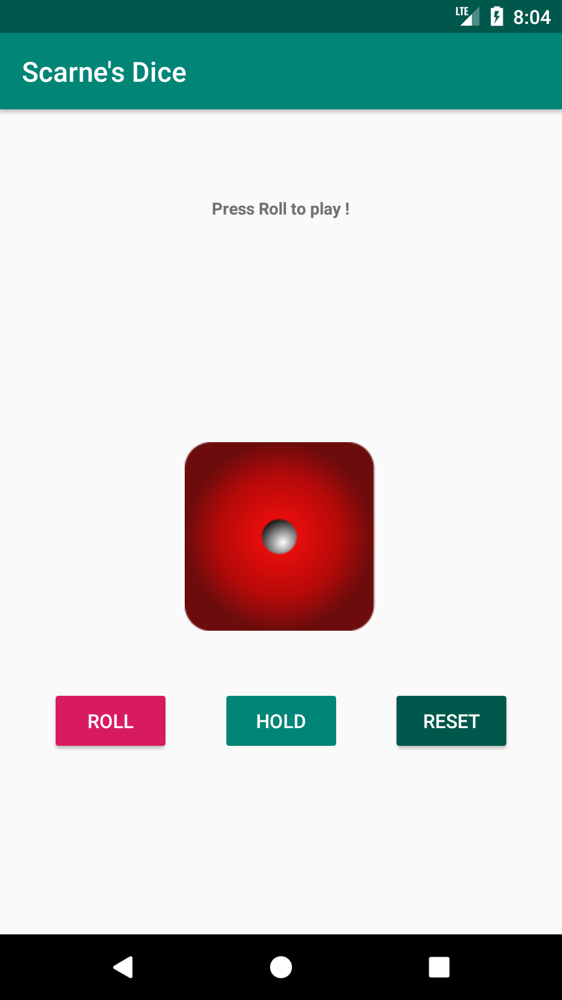
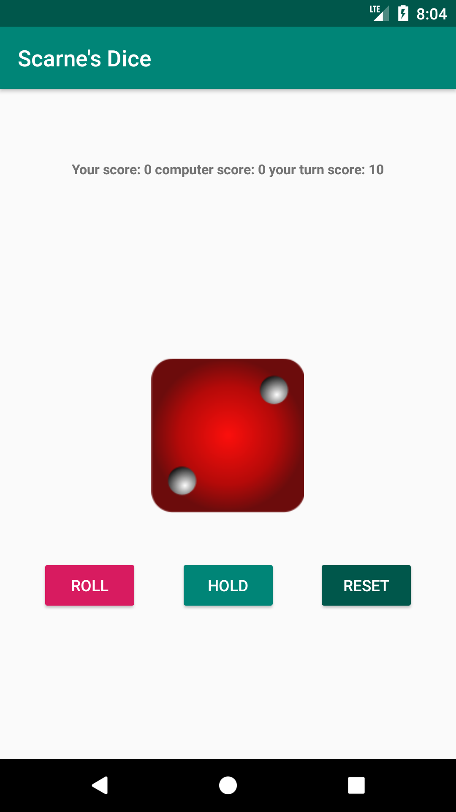
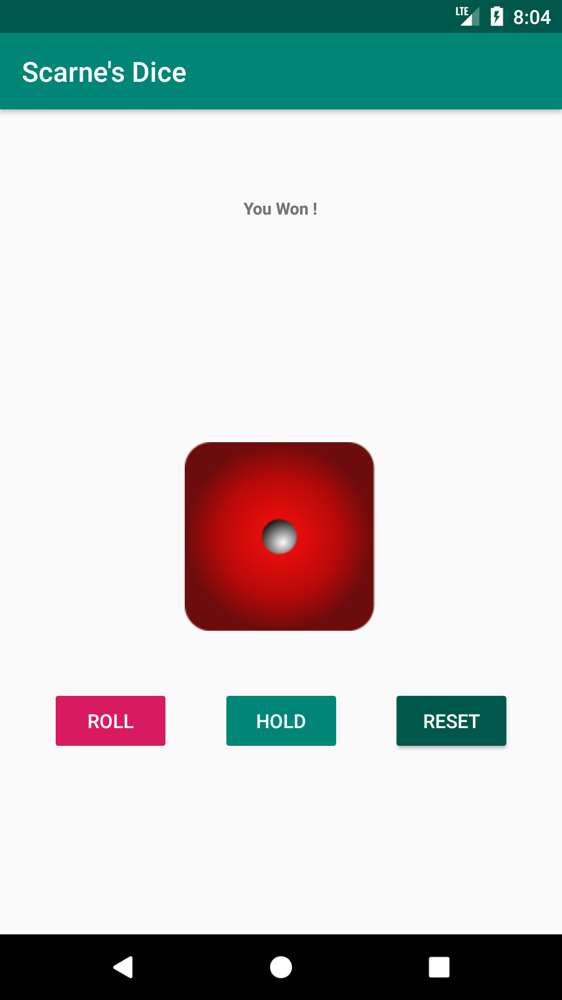

# 🎲 Scarne's Dice

A classic turn-based dice game for Android where you compete against the computer to reach 100 points first!

## 🎮 How to Play

**Scarne's Dice** is a strategic dice game with simple rules but engaging gameplay:

1. **Roll the dice** to accumulate points during your turn
2. **If you roll 1**: You lose all points from your current turn and your turn ends
3. **If you roll 2-6**: Add the rolled value to your turn score
4. **Hold**: Keep your turn score and add it to your total score, then end your turn
5. **First player to reach 100 points wins!**

The key strategy is deciding when to **hold** (secure your points) versus **risk** rolling again for more points.

## 🛠 Tech Stack

| Technology | Purpose |
|------------|---------|
|  | Core game logic |
|  | Mobile platform |
|  | IDE |

## 🚀 Getting Started

### Prerequisites
- Android Studio 3.4.1 or higher
- Android SDK API 25+ (Android 7.1)
- Java 8+

### Installation

1. **Clone the repository**
   ```bash
   git clone https://github.com/stabgan/Scarne-Dice.git
   cd Scarne-Dice
   ```

2. **Open in Android Studio**
   - Launch Android Studio
   - Select "Open an existing Android Studio project"
   - Navigate to the cloned directory

3. **Build and Run**
   - Connect an Android device or start an emulator
   - Click the "Run" button or press `Shift + F10`

## 🎯 Game Features

- **Smart Computer AI**: The computer uses strategy to decide when to hold vs. continue rolling
- **Intuitive UI**: Clean, simple interface with dice animations
- **Real-time Scoring**: Live score tracking for both player and computer
- **Game Reset**: Start a new game anytime with the reset button

## 📱 Screenshots

<div align="center">
  
  
  
</div>

## 🎲 Game Rules Details

### Scoring System
- Roll **1**: Lose turn, forfeit all turn points
- Roll **2-6**: Add to turn score, choose to roll again or hold
- **Hold**: Add turn score to total score, end turn
- **Win Condition**: First to 100 points wins

### Computer Strategy
The AI uses a balanced approach:
- Holds when ahead of the player
- Holds when turn score reaches 20+ points
- Takes calculated risks when behind

## 🔧 Technical Details

- **Target SDK**: Android API 29 (Android 10)
- **Minimum SDK**: Android API 25 (Android 7.1)
- **Architecture**: Single Activity with game state management
- **UI Framework**: ConstraintLayout with Material Design elements

## 📝 Recent Improvements

- ✅ Fixed dice roll logic (now properly generates 1-6 values)
- ✅ Corrected scoring system to match official Scarne's Dice rules
- ✅ Improved computer AI decision-making
- ✅ Enhanced UI state management
- ✅ Added proper game end conditions
- ✅ Better code organization and documentation

## 🤝 Contributing

1. Fork the repository
2. Create a feature branch (`git checkout -b feature/amazing-feature`)
3. Commit your changes (`git commit -m 'Add amazing feature'`)
4. Push to the branch (`git push origin feature/amazing-feature`)
5. Open a Pull Request

## 📄 License

This project is part of Google's Android Development coursework and is available for educational purposes.

## 🎓 About

This project was created as part of Google's "Learn Programming with Android" course. It demonstrates fundamental Android development concepts including:
- Activity lifecycle management
- UI event handling
- Game state management
- Handler-based animations
- Material Design principles

---

*Enjoy the game and may the dice roll in your favor! 🎲*